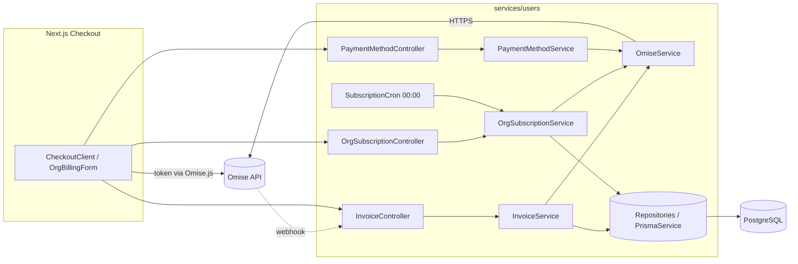
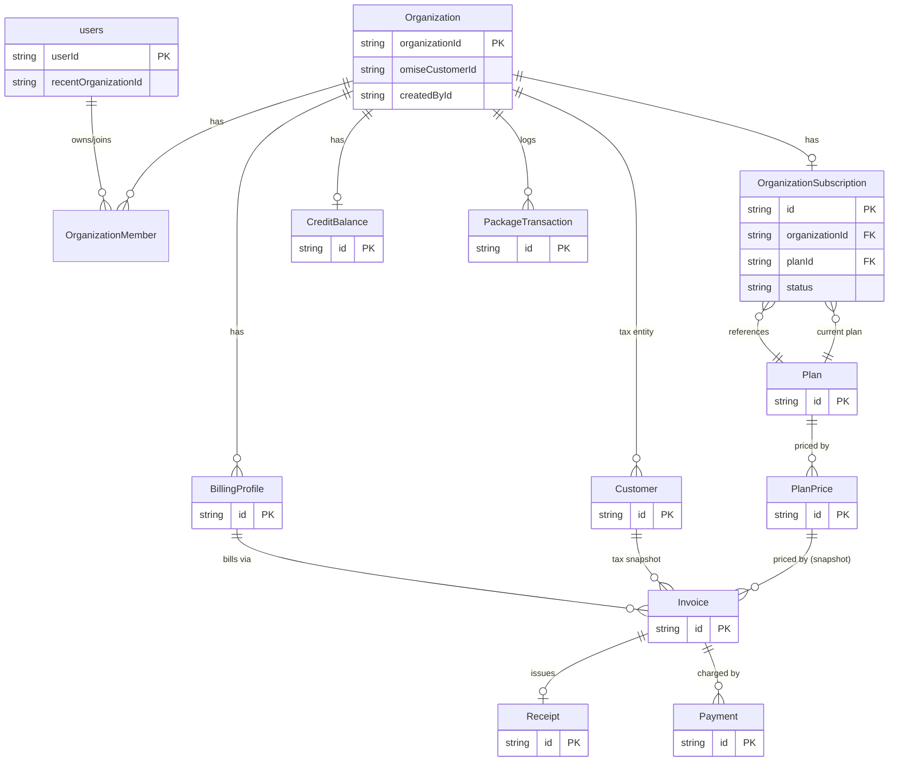
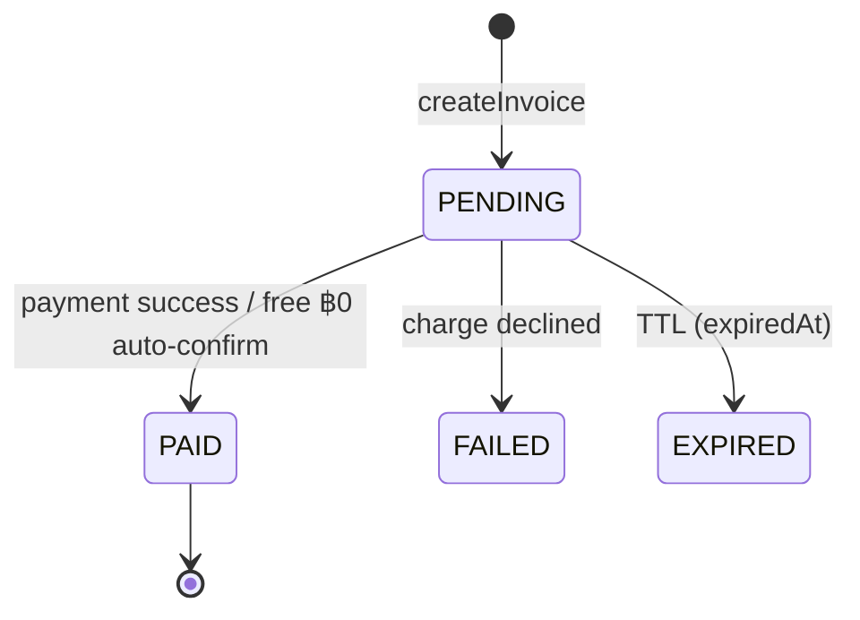
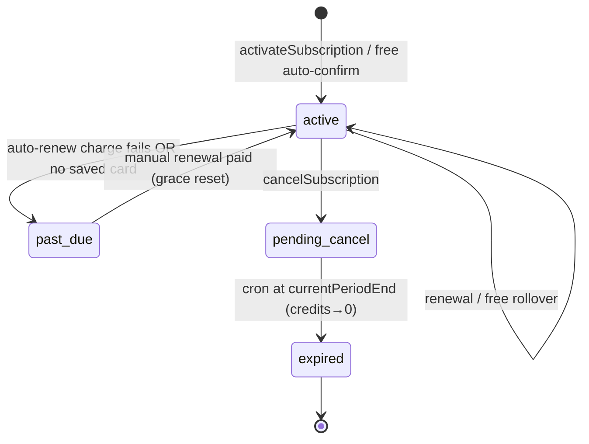
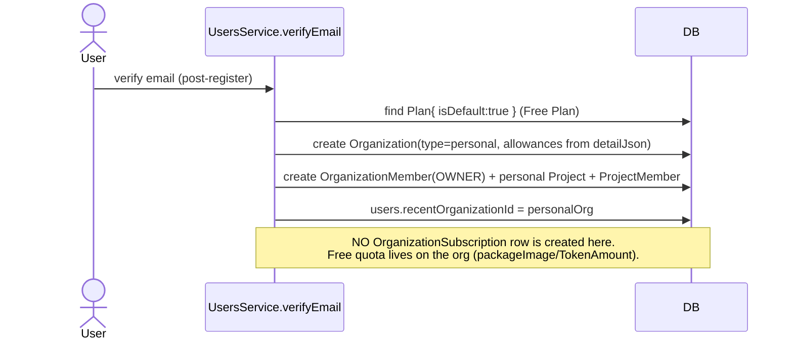
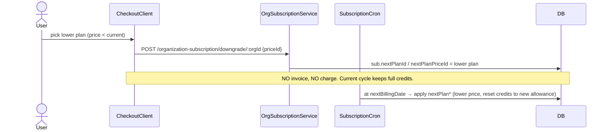

# Subscription & Payment System — Technical Architecture & System Design

**Status:** Production blueprint / SOP
**Source of truth:** `ai-media-backend` (NestJS) + `ai-media-frontend` (Next.js), Omise gateway, PostgreSQL/Prisma.
**Scope:** organizations, multi-tier plans (Free + Paid), Omise card/PromptPay/internet-banking, automatic & manual renewal, prorated upgrade, scheduled downgrade, cancellation, credit ledger.

This document captures the **concrete structural reality** of the code. Every table field, formula, and state transition traces to a real schema line or service method. Diagrams are Mermaid (render on GitHub / VS Code preview). Treat the "generic blueprint" callouts as the reusable SOP for other SaaS projects.

---

## 1. System Architecture & Component Overview

### 1.1 Architectural pattern

| Layer | Pattern | Concrete implementation |
|-------|---------|-------------------------|
| Deployment | **Modular monorepo of NestJS microservices** | `services/users` (payment/subscription owner), `services/core`, `email-*`, `report`, `worker-service`; shared lib `libs/share` (`@ai-media/share`) |
| Module | **NestJS feature modules** (Controller → Service → Repository) | `InvoiceModule`, `OrganizationSubscriptionModule`, `OmiseModule`, `PaymentMethodModule`, `BillingProfileModule`, `PurchaseModule` |
| Data access | **Repository Pattern** | `*Repository` classes in `@ai-media/share` wrapping a single `PrismaService` (e.g. `InvoiceRepository`, `OrganizationSubscriptionRepository`, `CreditBalanceRepository`). Services also use `PrismaService` directly for multi-entity `$transaction`s. |
| Scheduling | **Cron via `@nestjs/schedule`** | `OrganizationSubscriptionCron` (`@Cron('0 0 * * *')`) → `changeCycleSubscription()` |
| Gateway | **Thin REST adapter** (anti-corruption layer) | `OmiseService` — hand-rolled HTTP against `https://api.omise.co`, no SDK |

> **Blueprint note.** The payment domain is intentionally isolated in **one service** (`services/users`). All money-mutating writes happen inside `prisma.$transaction(...)`. The gateway is wrapped by a single adapter so the rest of the code never speaks raw Omise.

### 1.2 Core components & responsibilities

| Component | File | Responsibility |
|-----------|------|----------------|
| **InvoiceService** | `services/users/src/invoice/invoice.service.ts` | The lifecycle hub. `createInvoice` (branches new-org vs existing-org, prorates UPGRADE, free-plan guard, ฿0 auto-confirm), `payCard`/`paySource` (drive Omise), `confirmInvoice` (idempotent post-payment finalizer), `createOrganizationForInvoice` (org born here), `activateSubscription` (CREATE/RENEWAL), `applyUpgrade` (immediate prorated switch), `handleWebhook`. |
| **OmiseService** | `services/users/src/omise/omise.service.ts` | Gateway wrapper. `createCardCharge` (token), `chargeCustomerCard` (saved card), `createSourceCharge` (PromptPay/banking), `createCustomer`/`addCard`/`listCards`/`deleteCard`, `retrieveCharge` (authoritative re-fetch). Converts THB→satang. |
| **OrganizationSubscriptionService** | `services/users/src/organization-subscription/organization-subscription.service.ts` | Subscription state machine off the request path: `upgradeSubscription`, `downgradeSubscription` (schedule `nextPlan*`), `cancelSubscription` (→ `pending_cancel`), `changeCycleSubscription` (the daily engine: paid auto-charge, free rollover, per-cycle credit reset, cancellation expiry). |
| **OrganizationSubscriptionCron** | `…/organization-subscription.cron.ts` | Fires `changeCycleSubscription()` daily at **00:00**. |
| **PaymentMethodService** | `services/users/src/payment-method/payment-method.service.ts` | Saved cards: one **Omise Customer per organization** (`organization.omiseCustomerId`), created lazily on first `addCard`; list/add/delete. |
| **DocumentNumberService** | `services/users/src/document-number/…` | Atomic sequence numbers inside the transaction: `INV-YYYYMM######`, `RTI-YYYYMM######`, `C-######`. |
| **PurchaseService** | `services/users/src/purchase/purchase.service.ts` | Legacy payment-first "PendingPurchase" flow (parallel to the Invoice flow; shares the Omise webhook). |
| **BillingProfileService** | `services/users/src/billing-profile/…` | User tax-invoice profiles (reused/prefilled at checkout). |

### 1.3 Request vs background split



---

## 2. Data Engineering & Schema Design (ERD)

### 2.1 Entity relationships



> **Key modeling decision.** `Organization` has **two identifiers**: numeric `id` (autoincrement) and the business key `organizationId` (UUID, `VarChar(50)`). **All foreign keys use `organizationId`.** Some tables (`Invoice`, `BillingProfile`, `Customer`) store `organizationId` as a **scalar with no FK** so they can exist before the org row does; only `OrganizationMember`, `PackageTransaction`, `OrganizationSubscription`, `CreditBalance` enforce the FK.

### 2.2 Entity tables

#### `users` (`users`)
| Field | Type | Constraints | Description |
|-------|------|-------------|-------------|
| id | Int | PK, autoincrement | Internal id (not used as FK). |
| userId | VarChar(50) | Unique, default uuid | **Business key** — every user-scoped FK references this. |
| username | VarChar(100) | Unique | Login. |
| email | VarChar(200) | — | Contact. |
| status | VarChar(50) | default `active` | `active/inactive/deleted/banned/invite`. |
| recentOrganizationId | VarChar(50) | Nullable | The user's **currently active org** (switched after purchase). |
| token | VarChar(50) | Nullable | Keycloak linkage; **not** the JWT `sub`. |

> ⚠️ The frontend session exposes **both** `session.user.id` (Keycloak `sub`) and `session.user.userId` (this `users.userId`). Payment must use **`userId`**, or `OrganizationMember.userId` FK breaks.

#### `Organization` (`organization`)
| Field | Type | Constraints | Description |
|-------|------|-------------|-------------|
| id | Int | Unique, autoincrement | Internal. |
| organizationId | VarChar(50) | Unique, **default uuid** | Business key / universal FK target. **Generated only when the row is created** (never pre-minted). |
| name / slug | VarChar(150) | name required | Display + slug. |
| type | VarChar(50) | required | `personal` / `team`. |
| status | Boolean | default true | Active flag. |
| createdById | VarChar(50) | required | Owner (`users.userId`). Used by the free-plan guard. |
| maxUserAccess | Int | Nullable | Seat cap (from plan `detailJson`). |
| accessCodes | String[] | default `[image,video,omni,dream]` | Feature entitlements. |
| omiseCustomerId | VarChar(100) | Nullable | **Omise Customer** for saved cards (one per org; distinct from `organizationId`). |

#### `OrganizationSubscription` (`organization_subscriptions`)
| Field | Type | Constraints | Description |
|-------|------|-------------|-------------|
| id | UUID | PK | — |
| organizationId | VarChar(50) | **Unique**, FK→organization | One subscription per org. |
| planId | UUID | FK→Plan | Current plan. |
| planName / price / interval | snapshot | — | Denormalized current-cycle snapshot. |
| creditAllowance / imageAllowance | Float | default 0 | Per-cycle quota granted on reset. |
| currentPeriodStart / currentPeriodEnd | DateTime | required | Active **credit** cycle (use-it-or-lose-it reset boundary). |
| nextBillingDate | DateTime | required | When the next **payment** is due (cron trigger). |
| nextPlanId / nextPlanPriceId | UUID | Nullable | Scheduled plan for next cycle (downgrade / upgrade continuation). |
| autoRenew | Boolean | default true | **false** for free plans and cancelled subs. |
| status | String | default `active` | State machine — see §2.3. |
| periodCount / periodCurrent | Int | default 1 | Multi-cycle bookkeeping. |

#### `Plan` (`plans`) / `PlanPrice` (`plan_prices`)
| Field | Type | Constraints | Description |
|-------|------|-------------|-------------|
| Plan.id | UUID | PK | — |
| Plan.isDefault | Boolean | default false | **Marks the Free Plan.** Exactly one. |
| Plan.detailJson | JsonB | Nullable | `creditAllowance`, `imageAllowance`, `maxUserAccess`, `packageImageAmount`, `packageTokenAmount`. |
| Plan.accessCodes | String[] | — | Feature entitlements copied to the org. |
| PlanPrice.id | UUID | PK | Referenced by invoices/subscriptions. |
| PlanPrice.planId | UUID | FK→Plan | — |
| PlanPrice.interval | VarChar(20) | default MONTH | `MONTH` / `YEAR`. |
| PlanPrice.price | Decimal(10,2) | required | **Free Plan price = 0.** |
| PlanPrice.periodCount | Int | default 1 | Cycles covered by one payment. |

#### `Invoice` (`invoice`)
| Field | Type | Constraints | Description |
|-------|------|-------------|-------------|
| id | UUID | PK | — |
| invoiceNo | VarChar(30) | Unique | `INV-YYYYMM######`. |
| organizationId | VarChar(50) | **Nullable**, no FK | `null` for a PENDING new-org invoice; back-filled at confirm. |
| userId | VarChar(50) | required | Buyer (`users.userId`). |
| billingProfileId | UUID | required | Tax profile used. |
| customerId | UUID | Nullable | Set at confirm. |
| planId / planPriceId / planName / planInterval | snapshot | — | Purchased plan snapshot. |
| subTotal / vatAmount / totalAmount | Decimal(10,2) | required | VAT 7%; **UPGRADE stores the prorated difference**. |
| status | VarChar(20) | default `PENDING` | `PENDING/PAID/FAILED/EXPIRED/CANCELLED`. |
| paymentMethod | VarChar(20) | required | `CARD/PROMPTPAY/INTERNET_BANKING`. |
| changeType | String | Nullable | `CREATE/RENEWAL/UPGRADE` — drives confirm logic. |
| isNewOrganization | Boolean | default false | Marks the "create org after payment" path. |
| orgName / orgType / orgDescription | Nullable | — | New-org form snapshot (org built from these at confirm). |
| omiseCustomerId | VarChar(100) | Nullable | Parked for a new org, copied to the org at confirm. |
| expiredAt | DateTime | Nullable | PENDING TTL (1 day). |

#### `Payment` (`payment`) — gateway attempt log
| Field | Type | Constraints | Description |
|-------|------|-------------|-------------|
| id | UUID | PK | — |
| invoiceId | UUID | FK→Invoice, indexed | Owning invoice. |
| method | VarChar(20) | required | `CARD/PROMPTPAY/INTERNET_BANKING`. |
| omiseChargeId | VarChar(100) | Nullable, indexed | Gateway charge id. |
| omiseSourceId / authorizeUri / qrImageUri / bank | Nullable | — | Source-based payment artifacts. |
| status | VarChar(20) | default `PENDING` | Mirrors the Omise charge status. |
| rawPayload | JsonB | Nullable | Full charge object (audit). |

#### `Receipt` (`receipt`)
| Field | Type | Constraints | Description |
|-------|------|-------------|-------------|
| id | UUID | PK | — |
| receiptNo | VarChar(30) | Unique | `RTI-YYYYMM######`. |
| invoiceId | UUID | **Unique**, FK→Invoice | One receipt per invoice (idempotency guard). |
| preVatAmount / vatAmount / amount | Decimal(10,2) | required | Tax breakdown. |

#### `PackageTransaction` (`package_transactions`) — settled-payment ledger
| Field | Type | Constraints | Description |
|-------|------|-------------|-------------|
| id | UUID | PK | — |
| organizationId | VarChar(50) | **FK→organization** (non-null) | Only written **after** the org exists. |
| amountPaid | Decimal(10,2) | required | Amount for this event. |
| planId / planName / planInterval | snapshot | — | What was bought. |
| status | String | default WAIT | `complete` on success. |
| paymentMethod | String | Nullable | `renewal/upgrade/<method>`. |
| billingPeriodStart / billingPeriodEnd | DateTime | required | Coverage window. |

#### `CreditBalance` (`credit_balances`)
| Field | Type | Constraints | Description |
|-------|------|-------------|-------------|
| id | UUID | PK | — |
| organizationId | VarChar(50) | **Unique**, FK→organization | One ledger per org. |
| currentCycleBalance / currentCycleImage | Float | default 0 | **Cycle quota** — reset each cycle (use-it-or-lose-it). |
| onTopBalance / onTopImage | Float | default 0 | **Purchased add-on** credits — persist across cycles. |
| holdBalance / holdImage | Float | default 0 | Reserved for in-flight tasks. |

#### `BillingProfile` (`billing_profile`) / `Customer` (`customer`)
| Field | Type | Constraints | Description |
|-------|------|-------------|-------------|
| BillingProfile.id | UUID | PK | — |
| BillingProfile.userId | VarChar(50) | required | Owner. |
| BillingProfile.organizationId | VarChar(50) | **Nullable**, no FK | `null` until a new org is created at confirm. |
| BillingProfile.type | VarChar(20) | required | `INDIVIDUAL/JURISTIC` + conditional tax fields. |
| Customer.id | UUID | PK | — |
| Customer.customerCode | VarChar(20) | Unique | `C-######`. |
| Customer.(taxId, branchCode) | — | **Composite Unique** | Reuse rule: same tax+branch ⇒ reuse customer. |

#### `PendingPurchase` (`pending_purchase`)
Snapshot store for the **legacy payment-first flow** (`PurchaseService`): org form + billing + plan + amounts + `omiseChargeId` + `createdOrganizationId` + lifecycle `status`. Everything (org, billing, invoice, subscription) is materialized in `confirm()` after payment.

### 2.3 State machines


*Invoice status.*


*Subscription status. Free plans stay `active` forever (`autoRenew=false`, rolled forward, never billed).*

---

## 3. Subscription Lifecycle & Payment Workflows

### Workflow 1 — Signup & Free personal-org creation


### Workflow 2 — Paid checkout, new org (Card vs QR/Bank)
```mermaid
sequenceDiagram
  actor U as User
  participant FE as CheckoutClient
  participant IS as InvoiceService
  participant OM as OmiseService
  participant DB as DB
  U->>FE: fill org+billing, choose plan/price
  FE->>IS: POST /invoice {createNewOrganization, orgName, billing, userId=users.userId}
  IS->>DB: guard user exists; BillingProfile(orgId=null); Invoice(PENDING, orgId=null)
  IS-->>FE: invoice (PENDING)
  alt Card
    FE->>OM: tokenize card (Omise.js, client-side)
    FE->>IS: POST /invoice/:id/pay/card {token | cardId}
    IS->>OM: createCardCharge / chargeCustomerCard
    OM-->>IS: charge.status = successful
    IS->>IS: confirmInvoice(id)
  else PromptPay / Internet-banking
    FE->>IS: POST /invoice/:id/pay/source
    IS->>OM: createSourceCharge → QR / authorize_uri
    OM-->>IS: source charge (PENDING)
    IS-->>FE: qrImageUri / authorizeUri
    OM-->>IC: webhook charge.complete (or FE polling /status)
    IC->>IS: handleWebhook → confirmInvoice(id)
  end
  Note over IS,DB: confirmInvoice (idempotent; returns early if PAID)
  IS->>DB: createOrganizationForInvoice → Organization (id via @default(uuid()))
  IS->>DB: back-fill Invoice.orgId + BillingProfile.orgId; OWNER member; users.recentOrganizationId
  IS->>DB: reuse/create Customer; Invoice→PAID; Receipt; activateSubscription (credits reset full)
  IS-->>FE: PAID invoice (organizationId set)
  FE->>FE: session.update({organizationId}); go to /page/project
```

### Workflow 3 — Mid-cycle Upgrade (prorated difference, instant switch)
```mermaid
sequenceDiagram
  actor U as User
  participant FE as CheckoutClient
  participant IS as InvoiceService
  participant OM as OmiseService
  participant DB as DB
  U->>FE: pick higher plan for current org
  FE->>IS: POST /invoice {changeType:UPGRADE, organizationId}
  IS->>DB: load current sub (oldPrice, currentPeriodStart/End)
  Note over IS: subTotal = max(0,(newPrice-oldPrice)) * remainingDays / totalDaysOfPeriod
  IS-->>FE: invoice (prorated diff)
  FE->>IS: pay/card
  IS->>OM: charge prorated amount → successful
  IS->>IS: confirmInvoice → applyUpgrade
  Note over IS,DB: creditBalance = (newAllowance - oldAllowance) + remainingBalance<br/>sub switched NOW (planId/price/allowance); currentPeriod* kept; nextPlan*=new
  IS->>DB: PackageTransaction(paymentMethod='upgrade', amountPaid=diff)
```

### Workflow 4 — Mid-cycle Downgrade (next-cycle, no charge)


### Workflow 5 — Automatic Renewal (cron 00:00)
```mermaid
sequenceDiagram
  participant CRON as SubscriptionCron 00:00
  participant OSS as changeCycleSubscription
  participant OM as OmiseService
  participant DB as DB
  CRON->>OSS: run
  OSS->>DB: find subs where nextBillingDate = today
  loop each due sub
    alt Free plan (sub.price = 0)
      OSS->>DB: rollover free — reset credits, advance dates; stay active (no charge)
    else autoRenew = false (cancelled/lapsing paid)
      OSS-->>OSS: skip (handled by pending_cancel branch)
    else has saved card (org.omiseCustomerId)
      OSS->>OM: chargeCustomerCard(planPrice.price)
      alt success
        OSS->>DB: PackageTransaction; sub active + new dates; reset credits; org.status=true
      else decline / error
        OSS->>DB: sub.status = past_due (no credits)
      end
    else no saved card (QR/bank)
      OSS->>DB: sub.status = past_due (manual renewal required)
    end
  end
  OSS->>DB: 2nd pass — active subs at currentPeriodEnd → reset cycle credits
  OSS->>DB: 3rd pass — pending_cancel & currentPeriodEnd<=today → expired + credits 0
```

### Workflow 6 — Manual Renewal (before vs after expiry / grace)
```mermaid
sequenceDiagram
  actor U as User
  participant IS as InvoiceService.activateSubscription
  participant DB as DB
  U->>IS: pay renewal invoice (same plan)
  IS->>DB: load existingSub
  alt currentPeriodEnd in FUTURE (paid before expiry)
    Note over IS: start = currentPeriodEnd + 1 day (append seamlessly, no lost days)
  else expired (grace period)
    Note over IS: start = today (reset)
  end
  IS->>DB: new period start..start+periodCount; credits reset to full
```

### Workflow 7 — Cancellation (Active → Pending Cancel → Expired)
```mermaid
sequenceDiagram
  actor U as User
  participant OSS as OrgSubscriptionService
  participant CRON as SubscriptionCron
  participant DB as DB
  U->>OSS: POST /organization-subscription/cancel/:orgId
  OSS->>DB: autoRenew=false; status=pending_cancel (credits kept)
  Note over U,DB: user keeps access with current credits until currentPeriodEnd
  CRON->>DB: when currentPeriodEnd <= today → status=expired; credits currentCycle=0
```

---

## 4. Credits Management Architecture

### 4.1 Ledger model (`CreditBalance`, one row per org)
- **`currentCycleBalance` / `currentCycleImage`** — the spendable **cycle quota**; **reset** (overwritten, not incremented) each cycle → *use-it-or-lose-it*.
- **`onTopBalance` / `onTopImage`** — **purchased add-ons**; persist across cycles (never reset by the lifecycle).
- **`holdBalance` / `holdImage`** — reserved while a generation task is in flight.
- **Revoke access = set `currentCycle* = 0`** (cancellation expiry, past-due lapse). There is no separate "disabled" flag beyond credits + `subscription.status` + `organization.status`.

### 4.2 Exact formulas (as implemented)

**Upgrade — invoice amount (prorated difference)** — `InvoiceService.createInvoice`:
```
totalDaysOfPeriod = diff(currentPeriodEnd, currentPeriodStart)   // in days, min 1
remainingDays     = diff(currentPeriodEnd, now)                  // min 0
subTotal          = max(0, newPrice − oldPrice) × remainingDays / totalDaysOfPeriod
vat               = subTotal × 0.07 ; total = subTotal + vat
```

**Upgrade — credit adjustment (immediate)** — `InvoiceService.applyUpgrade`:
```
newCycleBalance = max(0, (newCreditAllowance − oldCreditAllowance) + remainingCurrentBalance)
newCycleImage   = max(0, (newImageAllowance  − oldImageAllowance)  + remainingCurrentImage)
// sub switched NOW: planId, price, interval, creditAllowance, imageAllowance := new plan
// currentPeriodStart/End and nextBillingDate are kept; nextPlan* := new plan
```

**New / Renewal** — `InvoiceService.activateSubscription`:
```
currentCycleBalance := creditAllowance   // full reset
currentCycleImage   := imageAllowance
autoRenew           := (planPrice.price ≠ 0)   // free ⇒ false
start := existingSub && currentPeriodEnd>now ? currentPeriodEnd+1d : today
```

**Per-cycle reset (paid) & free rollover** — `changeCycleSubscription`:
```
currentCycleBalance := sub.creditAllowance   // refresh to plan allowance
currentCycleImage   := sub.imageAllowance
```

### 4.3 Credit behavior across the 5 states
| State | Cycle credits |
|-------|---------------|
| **New (active)** | Reset to full plan allowance. |
| **Renewal (active)** | Reset to full; expiry appended from previous end (early) or today (grace). |
| **Upgrade (active)** | `(New−Old)+Remaining`, immediately. |
| **Downgrade (scheduled)** | Untouched this cycle; reset to the lower allowance at next cycle. |
| **Cancellation → expired / past_due** | Set to `0` (access revoked). |

---

## 5. Reusable Best Practices & Security Guardrails

### 5.1 Guardrails present in the code
- **Idempotent finalization.** `confirmInvoice` returns early when `invoice.status === 'PAID'`, so webhook + polling + retries cannot double-provision. `Receipt.invoiceId` is `@unique` (one receipt per invoice).
- **Never trust the webhook payload.** The public `POST /invoice/webhook/omise` route reads only `event.key` + `event.data.id`, then **re-fetches the authoritative charge** via `omiseService.retrieveCharge(chargeId)` before acting. (No blind trust of amount/status from the wire.)
- **Correct identity for FKs.** Payment uses **`users.userId`**, not the Keycloak `sub`; otherwise `OrganizationMember.userId` FK fails. Verified in the payment path.
- **No pre-minted org ids.** `organizationId` is DB-generated (`@default(uuid())`) **only at confirm**; the invoice/billing-profile carry `null` until then, so an abandoned checkout leaves **no ghost references**.
- **Free-plan abuse block.** Creating a new org on the Free Plan (`isDefault`) is rejected if the buyer already owns a **free-plan subscription** (`organizationSubscription.findFirst({ plan:{isDefault}, organization:{createdById:userId} })`).
- **Skip the gateway at ฿0.** Free/zero-total invoices are auto-confirmed server-side instead of sending a ฿0 charge Omise would reject.
- **Fail-fast validation before money moves.** Existence checks for user / organization / billing profile / plan run before any charge or write.
- **Atomicity.** Every multi-entity money mutation (create-org-and-activate, confirm, upgrade) runs inside `prisma.$transaction(...)` → all-or-nothing.
- **Least-privilege saved cards.** One **Omise Customer per org** (`omiseCustomerId`); single-use tokens are exchanged for a customer/card; raw PANs never touch the backend (tokenized client-side via Omise.js).

### 5.2 Edge-case checklist (any project reusing this blueprint must handle)
- [ ] **Double-submit / rapid re-clicks** on Pay — dedupe by reusing the existing PENDING invoice; keep `confirmInvoice` idempotent.
- [ ] **Webhook ⇄ polling race** — both may confirm the same charge; the PAID early-return must win.
- [ ] **Zero-amount / free tier** — bypass the gateway; still create subscription + receipt.
- [ ] **Auto-renew with no stored card** (PromptPay/bank) — do **not** silently renew for free; move to `past_due` and require manual renewal.
- [ ] **Grace-period reset** — paid after expiry ⇒ new cycle starts today; paid before expiry ⇒ appended.
- [ ] **Downgrade-then-upgrade within a cycle** — reconcile `nextPlan*` vs immediate switch so they don't fight.
- [ ] **Multi-period plans** (`periodCount>1`) — separate the monthly credit-reset boundary from the billing boundary.
- [ ] **Cron timezone & missed runs** — 00:00 in which TZ? make the daily engine idempotent and safe to re-run.
- [ ] **Proration rounding / negative diffs** — clamp to `≥ 0`; decide floor vs round for credits.
- [ ] **Currency minor units** — always convert to satang/cents at the gateway boundary; store major units.
- [ ] **PII in logs** — do not log full billing/tax fields or raw charge payloads at INFO.
- [ ] **Orphan PENDING invoices / billing profiles** — sweep by `status=PENDING` + TTL (`expiredAt`).

---

### Appendix — Source map
| Concern | File |
|---|---|
| Invoice lifecycle, confirm, org creation, upgrade, activation | `services/users/src/invoice/invoice.service.ts` |
| Subscription engine, cron passes, cancel/downgrade/upgrade | `services/users/src/organization-subscription/organization-subscription.service.ts` |
| Cron trigger | `services/users/src/organization-subscription/organization-subscription.cron.ts` |
| Omise adapter | `services/users/src/omise/omise.service.ts` |
| Saved cards | `services/users/src/payment-method/payment-method.service.ts` |
| Schema (all entities) | `libs/prisma/schema.prisma` |
| Checkout UI + org switch | `ai-media-frontend/app/page/payment/checkout/CheckoutClient.tsx` |
